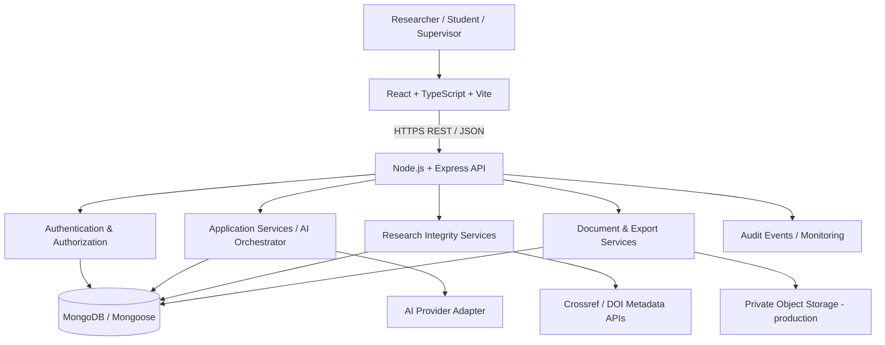
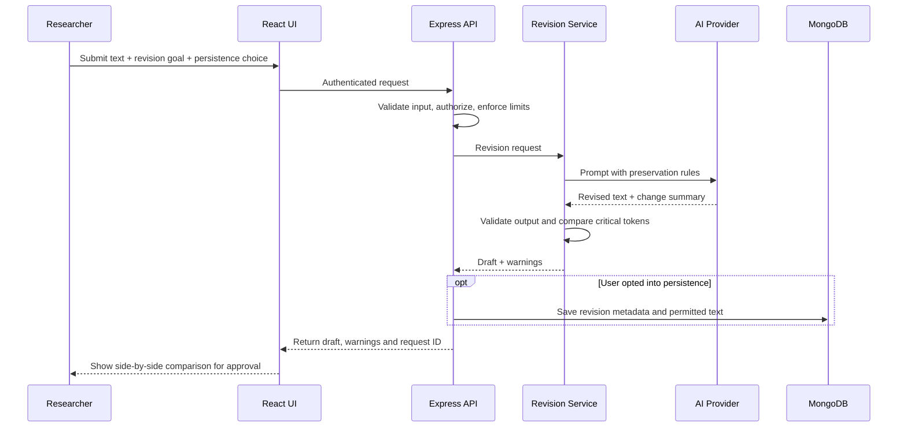

# ResearchProof AI — Complete System Architecture

## 1. Product goal

ResearchProof AI is an academic writing and research-integrity workspace. It helps researchers improve clarity and structure while preserving claims, uncertainty, citations, methods, statistics, and the author's intended meaning. It provides transparent writing diagnostics, citation/reference checks, document revision history, and research-integrity reports.

It does not promise to bypass Turnitin or other AI detectors. AI-writing indicators are uncertain and must not be treated as proof of authorship. Similarity results must state exactly what corpus was searched. Do not claim internet-wide or proprietary-database plagiarism detection without a licensed integration.

## 2. High-level architecture



### Request path
1. Browser sends a request to the Express API.
2. API applies security headers, origin policy, request-size limits, rate limits, validation and authentication.
3. Route authorizes the requested action and invokes a service.
4. Service uses MongoDB, an AI provider adapter, a metadata service, or export functionality as required.
5. API returns validated output and a request ID. Sensitive document text and secrets are excluded from logs.

## 3. Technology stack

### Current starter
- Frontend: React, TypeScript, Vite, CSS.
- Backend: Node.js, Express REST API.
- Database: MongoDB through Mongoose.
- Password hashing: bcryptjs.
- Authentication: JWT.
- Validation: Zod.
- Security foundations: Helmet, CORS configuration, express-rate-limit.
- AI: configurable OpenAI-compatible chat-completions adapter.

### Production additions
- HTTPS reverse proxy / managed ingress.
- Managed MongoDB with backups, encryption and least-privilege database user.
- Secret manager for API keys and signing secrets.
- Optional Redis for distributed rate limiting and job queues.
- Private object storage for uploaded documents and generated exports.
- Structured monitoring, error tracking and security audit logs.
- Optional background worker for long AI jobs, document conversion and DOI lookups.

## 4. Logical modules

1. **Identity and account**: registration, login, password hashing, JWT validation, account settings, role authorization, later email verification and password reset.
2. **Workspace and projects**: create projects, organize research documents, set document type and discipline, save drafts.
3. **Academic editor**: original text, proposed revision, side-by-side comparison, accept/reject changes, revision history.
4. **Meaning-preserving revision**: explicit user goal and tone, keep factual claims, numerical values, named entities, methods, limitations, citations and uncertainty unchanged unless user explicitly edits them. Return a change summary and flags requiring human review.
5. **Writing diagnostics**: sentence-length variation, repetition, vague wording, unsupported certainty, passive constructions and readability indicators. These are coaching signals, not an authorship verdict.
6. **Citation and reference integrity**: parse author-year citations and reference list; identify unmatched entries, incomplete fields and duplicates; optional DOI metadata verification via Crossref. Metadata matches do not prove that a source supports a claim.
7. **Similarity review**: initially checks repeated phrases inside the submitted document only. A later licensed source corpus can be integrated with clear scope and attribution.
8. **Research integrity**: flag missing evidence for factual claims, inconsistent numbers/dates, potential quotation/citation problems, methods/results inconsistencies and possible overstatement. These are prompts for researcher review, not automatic misconduct findings.
9. **Reports and exports**: downloadable report, revision comparison, reference checklist, Office Open XML DOCX import/export, and complete research integrity report export.
10. **APA 7 LaTeX Export Studio**: Word-to-LaTeX manuscript converter supporting official `apa7` document class for Student Papers (`stu`) and Professional Manuscripts (`man`), Biber biblatex references, booktabs tables, statistical notation preservation, sandboxed PDF compiler worker, and complete ZIP project packaging.
11. **Privacy and audit**: consent and persistence settings, deletion/export controls, access history, provider configuration, retention policy.
12. **Administration**: user management, usage limits, provider health and audit review; enforced with strict role checks.

## 5. Recommended repository structure

```text
researchproof-ai/
  README.md
  ARCHITECTURE.md
  package.json
  .gitignore
  client/
    package.json
    vite.config.ts
    src/
      main.tsx
      App.tsx
      styles.css
      components/           # editor, diff viewer, navigation, dialogs
      pages/                # dashboard, editor, projects, reports, settings
      services/api.ts       # centralized API client
      types/                # shared frontend types
  server/
    package.json
    .env.example
    src/
      index.js              # app bootstrap and route mounting
      middleware.js         # auth / validation / error middleware
      models.js             # Mongoose models in current starter
      services.js           # current service layer
      routes/               # split route files as platform grows
      controllers/          # HTTP request/response handling
      services/             # AI, citations, projects, reports
      providers/            # AI provider adapters
      validators/           # Zod request schemas
      utils/                # logger, errors, IDs
  tests/
    unit/
    integration/
    security/
  docs/
    API.md
    THREAT_MODEL.md
    DATA_RETENTION.md
```

The archive is a starter, not yet this fully split production structure. Refactor incrementally; do not create empty modules and assume they work.

## 6. Data model proposal

### User
- `_id`, `email` (normalized and unique), `passwordHash`, `displayName`, `role`, `createdAt`, `updatedAt`, `status`.
- Never store plaintext passwords or API keys.

### Project
- `_id`, `ownerId`, `title`, `discipline`, `documentType`, `createdAt`, `updatedAt`.
- Add indexes on `ownerId` and `updatedAt``.

### Document
- `_id`, `ownerId`, `projectId`, `title`, `currentRevisionId`, `persistenceConsent`, `createdAt`, `updatedAt`.
- Every query must enforce ownership/role authorization.

### Revision
- `_id`, `documentId`, `ownerId`, `revisionNumber`, `sourceText` or protected storage reference, `revisedText`, `changeSummary`, `modelProvider`, `modelName`, `createdAt`.
- Only save source/revised text when persistence is enabled and user consent is clear. Apply retention and deletion rules.

### IntegrityReport
- `_id`, `documentId`, `revisionId`, `ownerId`, `reportType`, `findings[]`, `limitations`, `createdAt`.
- A finding includes `category`, `severity`, `excerpt`, `explanation`, `suggestedAction`, and optional `sourceMetadata`.

### AuditEvent
- `_id`, `actorId`, `action`, `resourceType`, `resourceId`, `timestamp`, `requestId`, safe metadata`.
- Do not log document contents, passwords, access tokens, or API keys.

### ProviderConfig
- Prefer environment variables or a managed secret store, not a normal MongoDB collection containing raw secrets. Store non-secret preferences separately if required.

## 7. API design

Use `/api/v1` for a stable versioned API as it grows. Current starter routes may use a simpler `/api` prefix; align them during refactoring.

| Method | Endpoint | Purpose |
|---|---|---|
| GET | `/api/health` | Liveness/readiness check (avoid leaking configuration) |
| POST | `/api/auth/register` | Register account |
| POST | `/api/auth/login` | Authenticate |
| GET | `/api/projects` | List caller's projects |
| POST | `/api/projects` | Create project |
| GET | `/api/projects/:id` | Read authorized project |
| PATCH | `/api/projects/:id` | Update project |
| DELETE | `/api/projects/:id` | Delete project and apply retention rules |
| POST | `/api/revisions/humanize` | Request meaning-preserving revision |
| POST | `/api/analysis/writing` | Generate transparent writing diagnostics |
| POST | `/api/analysis/citations` | Check citation/reference consistency |
| POST | `/api/analysis/similarity` | Check in-document repeated phrases |
| GET | `/api/documents/:id/revisions` | List authorized revision metadata |
| GET | `/api/reports/:id` | Read authorized report |

For every route: validate input, authenticate, authorize ownership, set request-size/time limits, return consistent errors, and test cross-user access denial. Never trust a user-supplied `ownerId`.

## 8. AI orchestration flow



The AI must not silently fabricate citations, data, participant details, results or sources. It must preserve statistical values, sample sizes, p-values, effect sizes, quotations, uncertainty and study limitations. If the request cannot be safely completed, return warnings instead of inventing missing information. The researcher reviews and approves all revisions.

## 9. Citation verification strategy

1. Parse in-text citation patterns and bibliography entries.
2. Identify in-text citations with no matching reference and references never cited.
3. Normalize author names and years; flag ambiguous matches instead of silently merging them.
4. If a DOI exists, query a trusted metadata service such as Crossref and compare title, author, year and DOI.
5. Show metadata source and verification timestamp.
6. Clearly state that metadata validation cannot confirm that the cited paper supports a claim; that requires reading the source.

## 10. Security and privacy requirements

- HTTPS in deployed environments; Helmet and restrictive CORS.
- Strong password hashing; rate-limit login and costly AI endpoints.
- Short-lived access tokens and a planned refresh/revocation strategy. If using cookies, implement HttpOnly, Secure, SameSite and CSRF controls. Avoid storing long-lived bearer tokens in localStorage where possible.
- Zod validation, request-size caps, timeouts and output validation.
- Enforce owner checks on every project, document, revision and report.
- Keep secrets only in environment/secret management; commit `.env.example`, never `.env`.
- Avoid logging submitted text and personal/participant data.
- Provide explicit persistence consent, deletion, export and retention controls.
- Treat uploaded documents and AI output as untrusted input; guard against prompt injection and unsafe HTML rendering.
- Add dependency scanning, backups, restore tests, security tests and incident procedures before production.
- Academic data may contain sensitive participant information. Do not upload identifiable research data to an external model without appropriate consent, institutional approval and provider terms.

## 11. Deployment architecture

### Local development
- Vite frontend on port 5173.
- Express API on port 4000.
- Local MongoDB on port 27017 or MongoDB Atlas.
- AI provider called server-side only.

### Production
- Browser -> HTTPS reverse proxy / ingress -> frontend static assets and API.
- API -> private MongoDB network and secret manager.
- API -> approved external AI/metadata APIs through outbound HTTPS.
- Private object storage for uploaded documents if file support is added.
- Centralized monitoring and sanitized logs.
- Separate development, staging and production credentials and databases.

## 12. Testing strategy

- Unit tests: citation parsing, text comparison, prompt construction, validation and authorization helpers.
- API integration tests: registration/login, project ownership, persistence opt-out, invalid input and provider failure.
- Security tests: brute-force throttling, cross-user IDOR, oversized payloads, token expiry, injection attempts and secret leakage.
- AI quality tests: meaning preservation on academic passages containing negation, uncertainty, numbers, p-values, quotations, citations and methodological limitations.
- Regression tests: compare accepted revisions with originals and flag altered critical facts.
- Operational tests: MongoDB outage, AI provider timeout, rate limits, backups and restore.

## 13. Implementation roadmap

### Phase 1 — Local baseline & Secure Public Launch (Complete)
Dependencies, MongoDB models, JWT & Google authentication, security headers, rate limiting, and free-tier quotas.

### Phase 2 — Academic Tools Suite (Complete)
- **Academic Writing Studio**: 3-column workspace, responsive editor, debounced autosave, document version control with optimistic concurrency control (`doc.version`).
- **Meaning-Preserving Rewriting**: 8 specialized academic modes, deterministic meaning auditor checking negation reversals, statistical metrics, p-values, sample sizes, confidence intervals, and reference markers.
- **Diff & Revision Lifecycle**: Full revision tracking with Word/Paragraph diff highlighting, `accept`, `reject`, and `restore` endpoints.
- **Citation Assistant**: Crossref REST API lookup, APA 7th, MLA 9th, and IEEE formatters, and citation integrity auditor with in-memory TTL caching.
- **DOCX Import & Export**: Mammoth-based DOCX import with PKZIP magic byte security validation and `docx` library Office Open XML binary export streaming.
- **Automated Test Coverage**: 34 automated unit and integration tests passing with zero failures.

### Phase 3 — Platform Management & Governance (Complete)
- **Administrator Dashboard & User Management**: RBAC with `requireAdmin` middleware, real-time database-backed telemetry, user lifecycle controls (suspension, reactivation, session revocation), and append-only audit logging.
- **Usage Analytics Engine**: Privacy-preserving discrete event tracking, bounded retention with MongoDB TTL indexes, daily pre-aggregations, feature distributions, and error diagnostics.
- **Privacy Control Center & Data Deletion**: User-configurable cloud persistence, GDPR/CCPA data export, individual resource deletion, and cascade account deletion with step-up verification.
- **Research Integrity Reporting Engine**: Comprehensive academic auditing combining sentence complexity, deterministic meaning preservation, citation consistency, abbreviation tracking, and on-demand DOCX report generation.
- **Automated Test Coverage**: 45 automated unit and integration tests passing with zero failures.

### Phase 4 — Collaborative & Multi-Tenant Enhancements (Future)
Real-time collaborative editing via WebSockets/CRDT, institutional SSO (SAML), and advanced PDF generation.


