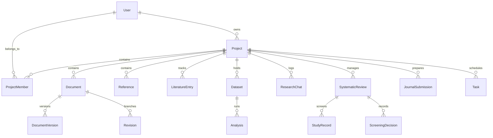

# ResearchProof AI 1.0 — Database Schema Reference

**Database Engine:** MongoDB (via Mongoose 8.9)  
**Primary Clustering:** MongoDB Atlas Replica Set  
**Isolation Architecture:** Project-scoped indexing & multi-tenant user ownership

---

## 1. Entity Relationship Overview



---

## 2. Core Collections Specification

### 2.1 Users (`users`)
```typescript
interface IUser {
  _id: ObjectId;
  email: string; // unique, lowercase, trimmed
  passwordHash?: string | null;
  googleId?: string | null;
  displayName: string;
  avatarUrl: string;
  authProviders: ('email' | 'google')[];
  emailVerified: boolean;
  role: 'researcher' | 'reviewer' | 'admin';
  status: 'active' | 'suspended' | 'pending' | 'deleted';
  tokenVersion: number;
  lastLoginAt: Date;
  lastActiveAt: Date;
  privacySettings: {
    persistDocumentText: boolean;
    allowAiProcessing: boolean;
  };
  preferences: {
    theme: string;
    compactSidebar: boolean;
    defaultCitationStyle: string;
    defaultRewriteMode: string;
    meaningPreservationStrictness: string;
  };
  usage: {
    dailyRequests: number;
    dailyLimit: any; // Mixed: Number or 'Unlimited'
    lastResetDate: Date;
  };
  createdAt: Date;
  updatedAt: Date;
}
```

### 2.2 Projects (`projects`) & Members (`project_members`)
```typescript
interface IProject {
  _id: ObjectId;
  userId: ObjectId; // Owner
  title: string;
  description: string;
  discipline: string;
  documentType: string;
  status: 'active' | 'archived' | 'deleted';
  tags: string[];
  workflowStage: 'literature' | 'analysis' | 'drafting' | 'review' | 'submission';
  completionPercentage: number;
  createdAt: Date;
  updatedAt: Date;
}

interface IProjectMember {
  _id: ObjectId;
  projectId: ObjectId;
  userId: ObjectId;
  role: 'owner' | 'editor' | 'reviewer' | 'viewer';
  invitedBy: ObjectId;
  status: 'active' | 'invited' | 'declined';
  permissions: string[];
  createdAt: Date;
}
```

### 2.3 Documents (`documents`) & Versions (`document_versions`)
```typescript
interface IDocument {
  _id: ObjectId;
  ownerId: ObjectId;
  projectId: ObjectId | null;
  title: string;
  content: string;
  version: number;
  wordCount: number;
  characterCount: number;
  currentRevisionId?: ObjectId | null;
  persistenceConsent: boolean;
  createdAt: Date;
  updatedAt: Date;
}

interface IDocumentVersion {
  _id: ObjectId;
  documentId: ObjectId;
  projectId: ObjectId;
  versionNumber: number;
  title: string;
  content: string;
  wordCount: number;
  authorId: ObjectId;
  changeSummary: string;
  createdAt: Date;
}
```

### 2.4 References & Citations (`references` / `citations`)
```typescript
interface IReference {
  _id: ObjectId;
  ownerId: ObjectId;
  projectId?: ObjectId | null;
  documentId?: ObjectId | null;
  doi?: string;
  title: string;
  authors: { given: string; family: string; name?: string }[];
  year?: string;
  journal?: string;
  volume?: string;
  issue?: string;
  pages?: string;
  publisher?: string;
  metadataSource: 'crossref' | 'bibtex' | 'ris' | 'manual';
  verificationStatus: 'verified' | 'unverified' | 'retracted' | 'manual';
  rawMetadata?: any;
  createdAt: Date;
  updatedAt: Date;
}
```

### 2.5 Literature Entries & Synthesis (`literature_entries`)
```typescript
interface ILiteratureEntry {
  _id: ObjectId;
  projectId: ObjectId;
  referenceId?: ObjectId;
  title: string;
  authors: string[];
  year: number;
  studyDesign: string; // RCT, cohort, qualitative, meta-analysis, etc.
  sampleSize: string;
  measurementTools: string[];
  coreFindings: string;
  limitations: string;
  thematicTags: string[];
  evidenceStrength: 'high' | 'moderate' | 'low';
  createdAt: Date;
}
```

### 2.6 Datasets & Statistical Analyses (`datasets` & `analyses`)
```typescript
interface IDataset {
  _id: ObjectId;
  projectId: ObjectId;
  ownerId: ObjectId;
  name: string;
  rowCount: number;
  columnCount: number;
  columns: {
    name: string;
    type: 'numeric' | 'categorical' | 'string' | 'date';
    missingCount: number;
  }[];
  dataRows: any[]; // Sample or embedded data matrix
  createdAt: Date;
}

interface IAnalysis {
  _id: ObjectId;
  projectId: ObjectId;
  datasetId: ObjectId;
  method: 'descriptive' | 'ttest' | 'anova' | 'correlation' | 'regression';
  parameters: any;
  results: {
    statisticName: string;
    statisticValue: number;
    pValue: number;
    degreesOfFreedom?: number | number[];
    effectSize?: { name: string; value: number };
    confidenceInterval?: [number, number];
    apaReport: string;
    diagnostics: any;
  };
  createdAt: Date;
}
```

### 2.7 Systematic Reviews & Screening (`systematic_reviews`)
```typescript
interface ISystematicReview {
  _id: ObjectId;
  projectId: ObjectId;
  title: string;
  protocol: {
    pico: { population: string; intervention: string; comparison: string; outcome: string };
    inclusionCriteria: string[];
    exclusionCriteria: string[];
  };
  prismaCounts: {
    identified: number;
    duplicatesRemoved: number;
    screenedTitleAbstract: number;
    excludedTitleAbstract: number;
    retrievedFullText: number;
    excludedFullText: number;
    includedStudies: number;
  };
  createdAt: Date;
}
```

### 2.8 Journal Submissions (`journal_submissions`)
```typescript
interface IJournalSubmission {
  _id: ObjectId;
  projectId: ObjectId;
  documentId: ObjectId;
  targetJournal: {
    name: string;
    publisher: string;
    issn?: string;
    scopeMatchScore: number;
    wordCountLimit: number;
    citationStyle: string;
    verifiedUrl: string;
  };
  complianceStatus: {
    wordCountCompliant: boolean;
    referencesCompliant: boolean;
    abstractCompliant: boolean;
    ethicsCompliant: boolean;
    score: number;
  };
  artifacts: {
    coverLetter: string;
    coiDeclaration: string;
    dataAvailabilityStatement: string;
  };
  createdAt: Date;
}
```

### 2.9 Project Tasks & Activity (`tasks` & `audit_events`)
```typescript
interface ITask {
  _id: ObjectId;
  projectId: ObjectId;
  title: string;
  status: 'todo' | 'in_progress' | 'completed';
  assignedTo?: ObjectId | null;
  dueDate?: Date | null;
  createdAt: Date;
}
```

