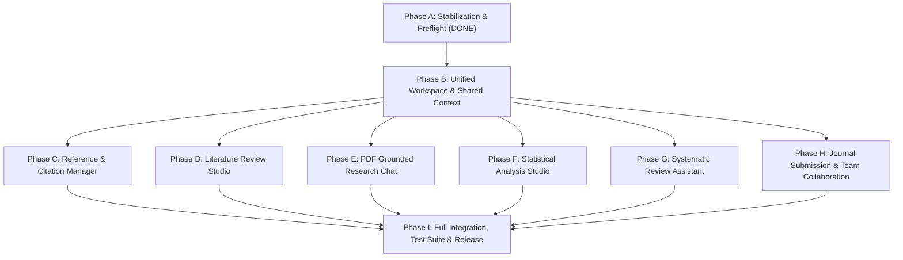

# ResearchProof AI 1.0 — Implementation Plan

**Target Release:** ResearchProof AI 1.0  
**Blueprint Scope:** 8 Unified Core Modules + Existing Writing & Integrity Engines + Shared Workspace  
**Status:** In Execution (Phase A Completed, Phase B Commencing)

---

## 1. Architectural Philosophy

ResearchProof AI 1.0 is engineered as an interconnected academic operating system rather than a disjointed set of AI tools:
1. **Unified Project Context**: All research activities (literature discovery, PDF chat, statistical analysis, systematic reviews, writing, integrity reviews, and journal submission) occur within the context of an active Project (`projectId`).
2. **Server-Side Authorization & Permissions**: Project ownership and team roles (`Owner`, `Editor`, `Reviewer`, `Viewer`) are strictly enforced at the API layer for all CRUD operations.
3. **Reproducibility & Evidence Grounding**:
   - Statistical calculations are computed using transparent numerical mathematical engines, never hallucinated by language models.
   - PDF Chat answers cite exact pages and passages.
   - Literature reviews trace extracted findings directly to verifiable DOI/citation records.
4. **Resilient Production Runtime**: Zero unhandled crashes, explicit `0.0.0.0` port bindings on Render, secure cookie delivery, and graceful degradation when external services are cold.

---

## 2. Phase Breakdown & Execution Sequence

---

### Phase A — Existing Application Stabilization (COMPLETED)
- [x] Fix Render 502 Bad Gateway (`x-render-routing: no-deploy`) by binding to `0.0.0.0` and removing synchronous boot exits.
- [x] Resolve registration security verification token error by implementing the frontend `TurnstileWidget` and conditional server verification.
- [x] Fix Mongoose `CastError` on `"Unlimited"` in `userSchema.usage.dailyLimit`.
- [x] Run regression test suite (31/31 passed) and verify zero-error Vite build (`tsc -b && vite build`).
- [x] Commit and push changes to `main` branch.
- [x] Generate `ARCHITECTURE_AUDIT.md` and `FEATURE_INVENTORY.md`.

---

### Phase B — Unified Workspace, Navigation & Project Infrastructure
- [ ] Implement canonical Mongoose schemas: `ProjectMember`, `Task`, `DocumentVersion`.
- [ ] Add backend endpoints under `/api/v1/projects`:
  - Project members, roles, and invitations
  - Project-scoped tasks and milestones
  - Activity timeline feed
- [ ] Update frontend sidebar navigation in `client/src/App.tsx` to match the 1.0 canonical blueprint:
  1. Overview / Dashboard
  2. My Research Projects
  3. Literature Review
  4. Reference Manager
  5. Statistical Analysis
  6. PDF Research Chat
  7. Systematic Reviews
  8. Journal Submission
  9. Research Collaboration
  10. Writing Studio
  11. Research Integrity
  12. Document Studio
  13. Settings
- [ ] Implement top bar Active Project Selector context provider in React.
- [ ] Verify test suite and frontend build.

---

### Phase C — Reference & Citation Manager
- [ ] Implement BibTeX and RIS file parsers and exporters.
- [ ] Add duplicate reference detection based on normalized DOI, title, and author heuristics.
- [ ] Add support for APA 7, MLA 9, Chicago 17, IEEE, and Harvard styles.
- [ ] Integrate Retraction Watch / retraction status flags on verified citations.
- [ ] Unit & integration tests for reference imports and formatting golden tests.

---

### Phase D — Literature Review Studio
- [ ] Build Literature Review schema: `LiteratureEntry`, `EvidenceExtract`, `SynthesisDraft`.
- [ ] Implement scholarly search and paper metadata import.
- [ ] Build Study Matrix UI: methodology, sample size, measurement instruments, core findings, limitations.
- [ ] Implement thematic clustering and evidence-based synthesis generation with direct source citations.

---

### Phase E — PDF Research Chat
- [ ] Add secure PDF upload endpoint with memory buffer processing and validation.
- [ ] Implement PDF text extraction and page-aware chunking engine.
- [ ] Implement grounded question-answering service citing page numbers and excerpt previews.
- [ ] Add interactive PDF passage viewer and chat conversation history persistence.

---

### Phase F — Statistical Analysis Studio
- [ ] Implement CSV and Excel (.xlsx) file ingestion and preview with automatic variable classification (Numeric, Categorical, Date).
- [ ] Build pure JavaScript numerical compute engine:
  - Descriptive statistics (Mean, Median, SD, Variance, Skewness, Kurtosis, IQR)
  - Inferential tests: Independent & Paired Samples t-tests, One-Way ANOVA, Pearson & Spearman Correlation, Linear Regression
  - Assumption diagnostics: Normality (Shapiro-Wilk approximation), Homogeneity of Variance
  - Effect sizes (Cohen's d, Eta-squared, R-squared) and 95% Confidence Intervals
- [ ] Render interactive charts (Histograms, Scatter Plots, Boxplots, Correlation Matrices).
- [ ] Generate APA 7 formatted statistical summary tables and reproducible analysis run logs.

---

### Phase G — Systematic Review Assistant
- [ ] Build Systematic Review schemas: `SystematicReview`, `StudyRecord`, `ScreeningDecision`.
- [ ] Implement review protocol configuration (inclusion/exclusion criteria).
- [ ] Build Dual-Screening workflow (Title/Abstract screening, Full-Text screening) with conflict resolution.
- [ ] Generate real-time PRISMA 2020 flow diagram metrics (Identification, Screening, Eligibility, Included).

---

### Phase H — Journal Submission Studio & Research Collaboration
- [ ] Build Journal Submission schemas: `JournalProfile`, `JournalSubmission`, `Comment`, `Invitation`.
- [ ] Implement journal guideline compliance checker (word counts, reference styles, required sections).
- [ ] Generate structured cover letters, declarations (COI, data availability), and submission checklist.
- [ ] Build collaboration layer: Project member invitations, role permissions, threaded document comments.

---

### Phase I — Full Integration, Verification & Release Sign-Off
- [ ] Connect existing Writing Studio and Research Integrity tools to active project context.
- [ ] Update and expand test suites across all new modules (targeting 50+ automated tests).
- [ ] Compile `API_DOCUMENTATION.md`, `DATABASE_SCHEMA.md`, `TEST_REPORT.md`, `SECURITY_AUDIT.md`, and `PRODUCTION_RELEASE_REPORT.md`.
- [ ] Perform live production verification on Render.
