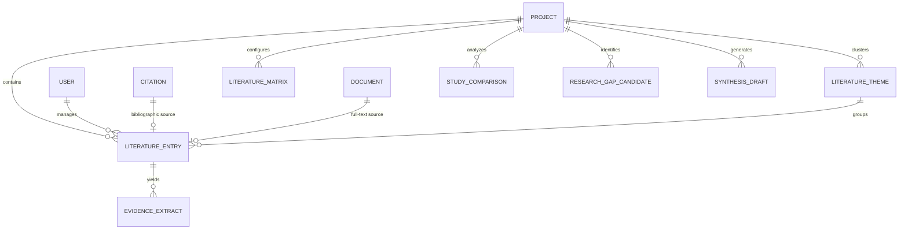

# ResearchProof AI 1.0 — Phase 5 Database Schema Specification
## Literature Review Studio Models & Relational Architecture

### 1. Overview
The Literature Review Studio models provide persistent, project-scoped storage for academic literature discovery, evidence extraction, matrix synthesis, study comparisons, thematic clustering, and candidate research gap analysis.

---

### 2. Entity Relationship Diagram (Mermaid)

---

### 3. Schema Definitions

#### 3.1. `LiteratureEntry`
Represents an individual research study, paper, or trial under systematic review.
- `_id`: ObjectId (Primary key)
- `projectId`: ObjectId (Ref: `Project`, required, indexed)
- `userId`: ObjectId (Ref: `User`, required, indexed)
- `referenceId`: ObjectId (Ref: `Citation`/`Reference`, optional, indexed)
- `documentId`: ObjectId (Ref: `Document`, optional)
- `title`: String (required, trimmed)
- `authors`: Array of Strings (or structured names)
- `year`: String
- `journal`: String
- `doi`: String (trimmed)
- `normalizedDoi`: String (indexed)
- `url`: String
- `abstract`: String
- **Structured Evidence Fields**:
  - `researchQuestion`: String
  - `studyObjectives`: String
  - `studyDesign`: String (`Quantitative`, `Qualitative`, `Mixed`, `RCT`, `Cohort`, `Systematic Review`, etc.)
  - `methodology`: String
  - `population`: String
  - `sampleSize`: String
  - `samplingMethod`: String
  - `participantCharacteristics`: String
  - `geographicSetting`: String
  - `measures`: String
  - `variables`: String
  - `interventionOrExposure`: String
  - `comparisonGroup`: String
  - `statisticalMethods`: String
  - `keyFindings`: String
  - `effectEstimates`: String
  - `limitations`: String
  - `futureDirections`: String
  - `qualityNotes`: String
- `matrixData`: Embedded object for customizable matrix columns
- `thematicTags`: Array of Strings
- `keywords`: Array of Strings
- `tags`: Array of Strings
- `extractionStatus`: Enum (`unextracted`, `extracting`, `extracted`, `reviewed`, `verified`)
- `status`: Enum (`identified`, `screened`, `included`, `excluded`)
- `createdBy`: ObjectId (Ref: `User`)
- `deletedAt`: Date (Soft deletion support)
- Timestamps (`createdAt`, `updatedAt`)

#### 3.2. `EvidenceExtract`
Granular, verifiable evidence snippets tied to exact text and page locations.
- `_id`: ObjectId
- `projectId`: ObjectId (Ref: `Project`)
- `literatureEntryId`: ObjectId (Ref: `LiteratureEntry`, indexed)
- `documentId`: ObjectId (Ref: `Document`)
- `pageNumber`: Number
- `section`: String (e.g., `Methods`, `Results`, `Discussion`, `Abstract`)
- `sourceText`: String (Exact quoted passage)
- `extractedField`: String (e.g., `sampleSize`, `effectSize`, `statisticalMethods`)
- `extractedValue`: String
- `extractionMethod`: Enum (`automatic`, `manual`)
- `confidenceOrReviewStatus`: Enum (`pending_review`, `verified`, `rejected`)
- `verifiedBy`: ObjectId (Ref: `User`)
- `verifiedAt`: Date

#### 3.3. `LiteratureMatrix`
Configurable tabular matrix representation of the review literature.
- `_id`: ObjectId
- `projectId`: ObjectId (Ref: `Project`)
- `userId`: ObjectId (Ref: `User`)
- `name`: String
- `description`: String
- `columns`: Array of `{ key, label, visible, order, width, type }`
- `sortConfig`: `{ key, order }`
- `savedFilters`: Mixed

#### 3.4. `LiteratureTheme`
Thematic synthesis categories.
- `_id`: ObjectId
- `projectId`: ObjectId (Ref: `Project`)
- `userId`: ObjectId (Ref: `User`)
- `name`: String
- `description`: String
- `color`: String (HEX code)
- `studyIds`: Array of ObjectIds (Ref: `LiteratureEntry`)
- `notes`: String
- `summary`: String

#### 3.5. `StudyComparison`
Comparative side-by-side matrices comparing 2–5 selected studies.
- `_id`: ObjectId
- `projectId`: ObjectId (Ref: `Project`)
- `userId`: ObjectId (Ref: `User`)
- `title`: String
- `studyIds`: Array of ObjectIds (Ref: `LiteratureEntry`)
- `dimensions`: Array of Strings
- `comparisonMatrix`: Mixed (Structured tabular comparison)
- `summary`: String

#### 3.6. `ResearchGapCandidate`
AI-assisted and empirical candidate research gaps grounded in reviewed studies.
- `_id`: ObjectId
- `projectId`: ObjectId (Ref: `Project`)
- `userId`: ObjectId (Ref: `User`)
- `title`: String
- `description`: String
- `category`: Enum (`population`, `methodological`, `measurement`, `geographic`, `theoretical`, `inconsistent_findings`, `understudied_variables`, `longitudinal`)
- `supportingStudyIds`: Array of ObjectIds (Ref: `LiteratureEntry`)
- `contradictoryStudyIds`: Array of ObjectIds (Ref: `LiteratureEntry`)
- `evidenceBasis`: String
- `limitationsOfLiterature`: String
- `suggestedResearchQuestions`: Array of Strings
- `status`: Enum (`candidate`, `accepted`, `dismissed`)

#### 3.7. `SynthesisDraft`
Evidence-linked synthesis drafts with versioning.
- `_id`: ObjectId
- `projectId`: ObjectId (Ref: `Project`)
- `userId`: ObjectId (Ref: `User`)
- `title`: String
- `type`: Enum (`narrative`, `thematic`, `chronological`, `methodological`, `comparative`)
- `studyIds`: Array of ObjectIds (Ref: `LiteratureEntry`)
- `themeIds`: Array of ObjectIds (Ref: `LiteratureTheme`)
- `sections`: Array of `{ title, theme, studyCount, synthesisText, citations }`
- `fullDraft`: String (Markdown/HTML)
- `evidenceLinks`: Array of `{ claimText, evidenceExtractId, studyId }`
- `version`: Number
- `versions`: Array of `{ versionNumber, fullDraft, createdAt }`
