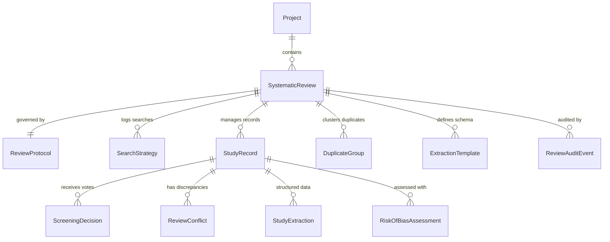

# RESEARCHPROOF AI 1.0 — PHASE 8 DATABASE SCHEMA SPECIFICATION
## SYSTEMATIC REVIEW ASSISTANT & PRISMA 2020 EVIDENCE SYNTHESIS

### 1. Document Information
- **Application**: ResearchProof AI 1.0
- **Phase**: 8 — Complete Systematic Review Assistant & PRISMA 2020 Flow Engine
- **Target Storage**: MongoDB Atlas & Mongoose Models (with In-Memory Dev Store Parity)
- **Status**: Production Grade / Verified

---

### 2. Entity-Relationship Overview

---

### 3. Collection Specifications

#### 3.1 `systematicreviews`
Stores review-level configuration, registration details, PICOS framework boundaries, dual-reviewer policies, and PRISMA 2020 live counters.

| Field | Type | Required | Description |
|---|---|---|---|
| `_id` | ObjectId | Yes | Unique identifier for the systematic review |
| `projectId` | ObjectId / String | No | Linked project identifier (optional for standalone reviews) |
| `userId` | ObjectId / String | Yes | Review author / principal investigator |
| `title` | String | Yes | Review title |
| `reviewType` | String | Yes | Enum: `systematic_review`, `scoping_review`, `meta_analysis`, `rapid_review` |
| `status` | String | Yes | Enum: `protocol_drafting`, `search_executed`, `screening_active`, `full_text_active`, `data_extraction`, `synthesis_complete`, `archived` |
| `currentStage` | String | Yes | Enum: `protocol`, `search`, `screening`, `full_text`, `extraction`, `synthesis` |
| `registration` | Object | Yes | PROSPERO / OSF registration tracking (`registered`, `registryName`, `registrationNumber`, `protocolUrl`) |
| `picosFramework` | Object | Yes | Structured PICO components (`population`, `intervention`, `comparator`, `outcomes`, `studyDesign`) |
| `eligibility` | Object | Yes | `inclusionCriteria` (array of strings), `exclusionCriteria` (array of strings) |
| `screeningSettings` | Object | Yes | `dualReviewerMode` (boolean), `blindScreening` (boolean), `adjudicationMethod` (string), `minimumReviewersPerRecord` (number) |
| `prismaMetrics` | Object | Yes | Live PRISMA flow counters (`identified`, `duplicatesRemoved`, `screenedTitleAbstract`, `excludedTitleAbstract`, `soughtFullText`, `notRetrievedFullText`, `assessedFullText`, `excludedFullText`, `includedInSynthesis`) |
| `checklistStatus` | Map / Object | No | Key-value store of 27 PRISMA 2020 checklist items with compliance statuses |
| `deletedAt` | Date | No | Timestamp for soft deletion |
| `createdAt` / `updatedAt` | Date | Yes | Timestamps |

---

#### 3.2 `studyrecords`
Represents an individual publication, trial, or report under consideration.

| Field | Type | Required | Description |
|---|---|---|---|
| `_id` | ObjectId | Yes | Unique study record identifier |
| `reviewId` | ObjectId / String | Yes | Parent systematic review identifier |
| `searchRunId` | ObjectId / String | No | Search execution run that identified this record |
| `title` | String | Yes | Record title |
| `authors` | Array[String] | Yes | Author list |
| `year` | String | No | Publication year |
| `journal` | String | No | Journal or conference venue |
| `doi` | String | No | Digital Object Identifier (normalized) |
| `pmid` | String | No | PubMed identifier (normalized) |
| `abstract` | String | No | Paper abstract |
| `sourceDatabase` | String | Yes | Identifying database (e.g. PubMed, Scopus, CENTRAL) |
| `sourceType` | String | Yes | Enum: `database`, `register`, `other_methods` |
| `screeningStage` | String | Yes | Enum: `pre_screen`, `title_abstract`, `full_text`, `included`, `excluded` |
| `decision` | String | Yes | Enum: `pending`, `included`, `excluded`, `unclear` |
| `exclusionReason` | String | No | Mandatory exclusion rationale under PRISMA 2020 |
| `deduplicationStatus` | String | Yes | Enum: `unique`, `duplicate`, `canonical` |
| `duplicateOfRecordId` | ObjectId / String | No | Canonical record reference if duplicate |
| `fullTextStatus` | String | Yes | Enum: `not_sought`, `sought`, `not_retrieved`, `assessed` |
| `fullTextPdfUrl` | String | No | Stored URL or path to full-text PDF |

---

#### 3.3 `reviewprotocols`
Stores formal protocol versions, objectives, and historical amendments.

| Field | Type | Description |
|---|---|---|
| `reviewId` | ObjectId / String | Parent review identifier |
| `title` | String | Protocol title |
| `framework` | String | `PICO`, `PICOS`, `PECO`, or `SPIDER` |
| `background` | String | Scientific rationale |
| `objectives` | String | Primary and secondary review questions |
| `version` | Number | Monotonically increasing version counter |
| `amendments` | Array[Object] | Historical log of amendments (`version`, `date`, `reason`, `authorId`) |

---

#### 3.4 `screeningdecisions`
Records atomic decisions made by individual reviewers in single or blind dual screening mode.

| Field | Type | Description |
|---|---|---|
| `reviewId` | ObjectId / String | Parent review identifier |
| `recordId` | ObjectId / String | Evaluated study record |
| `reviewerId` | ObjectId / String | Reviewer user identifier |
| `stage` | String | `title_abstract` or `full_text` |
| `decision` | String | `included`, `excluded`, or `unclear` |
| `reason` | String | Applied exclusion reason or notes |
| `confidenceScore` | Number | Confidence ratio (0.0 to 1.0) |

---

#### 3.5 `reviewconflicts`
Tracks disagreements between dual screeners until resolved by consensus or an adjudicator.

| Field | Type | Description |
|---|---|---|
| `reviewId` | ObjectId / String | Parent review identifier |
| `recordId` | ObjectId / String | Disputed record |
| `stage` | String | `title_abstract` or `full_text` |
| `decisions` | Array[Object] | Conflicting reviewer votes |
| `status` | String | `pending` or `resolved` |
| `adjudicatorId` | ObjectId / String | Third reviewer or principal investigator |
| `finalDecision` | String | `included` or `excluded` |
| `resolutionNotes` | String | Adjudication rationale |

---

#### 3.6 `riskofbiasassessments`
Stores formal methodological bias assessments using Cochrane RoB 2, ROBINS-I, or QUADAS-2.

| Field | Type | Description |
|---|---|---|
| `reviewId` | ObjectId / String | Parent review identifier |
| `recordId` | ObjectId / String | Assessed included study |
| `toolName` | String | `RoB 2`, `ROBINS-I`, or `QUADAS-2` |
| `assessorId` | ObjectId / String | Evaluating researcher |
| `domainAssessments` | Array[Object] | Domain ID, judgment (`low`, `some_concerns`, `high`), and supporting quotation |
| `overallJudgment` | String | Deterministic overall risk of bias judgment |
| `consensusReached` | Boolean | True if peer-agreed |

