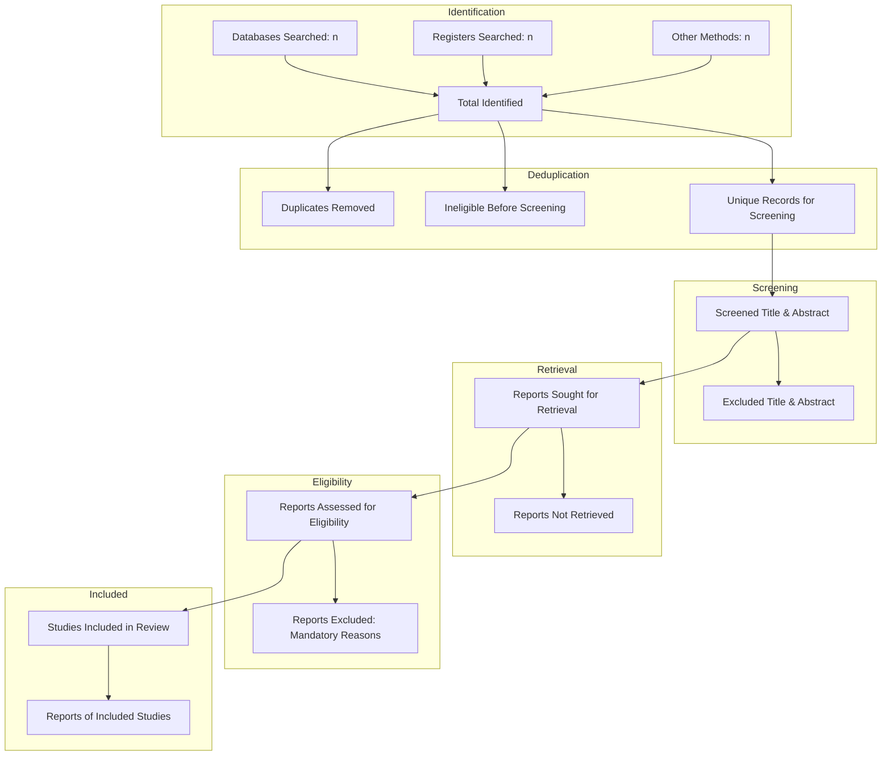

# RESEARCHPROOF AI 1.0 — PHASE 8 PRISMA VALIDATION SPECIFICATION
## MATHEMATICAL RECONCILIATION & INTEGRITY CONSTRAINTS

### 1. Statement of Principle
Under the PRISMA 2020 Statement (Page et al., 2021), systematic reviews must maintain complete mathematical consistency across identification, screening, retrieval, eligibility, and inclusion numbers. Numbers must never be estimated, fabricated, or rounded.

---

### 2. Reconciliation Formulas

#### Formula 1: Identification & Deduplication
$$\text{Total Identified} = \text{Identified}_{\text{Databases}} + \text{Identified}_{\text{Registers}} + \text{Identified}_{\text{Other}}$$
$$\text{Non-Duplicate Records} = \text{Total Identified} - \text{Duplicates Removed} - \text{Ineligible Pre-Screen}$$

#### Formula 2: Screening & Retrieval
$$\text{Reports Sought for Retrieval} = \text{Screened}_{\text{Title/Abstract}} - \text{Excluded}_{\text{Title/Abstract}}$$
$$\text{Reports Assessed for Eligibility} = \text{Reports Sought} - \text{Reports Not Retrieved}$$

#### Formula 3: Eligibility & Inclusion
$$\text{Studies Included in Review} = \text{Reports Assessed} - \text{Excluded}_{\text{Full-Text}}$$
$$\text{Excluded}_{\text{Full-Text}} = \sum_{r \in \text{Reasons}} \text{Count}(r)$$

---

### 3. Automated Validation Checks

The PRISMA Reconciliation Engine (`reconcilePrisma2020Metrics`) runs the following checks on every state transition:

1. **Identification Bound**: Total non-duplicate records cannot exceed total identified records.
2. **Screening Conservation**: The sum of sought full texts and title exclusions cannot exceed screened non-duplicate records.
3. **Retrieval Accounting**: Reports assessed must equal reports sought minus reports not retrieved.
4. **Inclusion Parity**: Studies included must strictly equal reports assessed minus reports excluded at full text.
5. **Reason Completeness**: The sum of reports in the exclusion reasons breakdown must exactly equal the total full-text excluded count.

