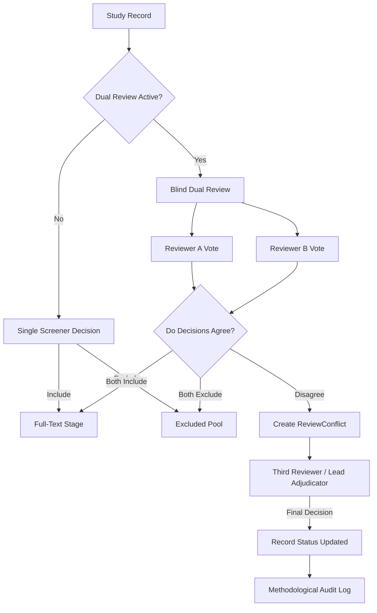

# RESEARCHPROOF AI 1.0 — PHASE 8 SCREENING WORKFLOW SPECIFICATION
## DUAL-REVIEWER METHODOLOGY, BLIND SCREENING, & CONFLICT ADJUDICATION

### 1. Overview
The Systematic Review Assistant enforces the methodological standards established by the Cochrane Handbook and the PRISMA 2020 statement. This document defines the dual-reviewer screening workflow, conflict resolution protocol, and decision boundaries.

---

### 2. Dual-Reviewer Architecture

---

### 3. Workflow Stages

#### Stage 1: Protocol & Eligibility Definition
1. The review team authors a formal protocol using PICOS (Population, Intervention, Comparator, Outcomes, Study Design).
2. Explicit inclusion and exclusion criteria are established before searching.
3. Registration details (PROSPERO ID, OSF registration) are linked.

#### Stage 2: Deduplication Pre-Screening
1. Records imported from databases and citation managers are normalized (DOI, PMID, title characters).
2. Exact matches (matching DOI, PMID, or $\ge 98\%$ title similarity with matching year) are automatically flagged as duplicates.
3. Probable matches ($\ge 88\%$ title similarity with author overlap) are queued for researcher verification.
4. Duplicate records are retained for auditing with a link to the canonical record.

#### Stage 3: Title & Abstract Screening
1. In **Single Mode**, a decision immediately advances or excludes the record.
2. In **Blind Dual Mode**:
   - Neither reviewer can view the other reviewer's evaluation or notes until both submit.
   - If both vote `included`, the record advances to Full-Text assessment.
   - If both vote `excluded`, the record is excluded.
   - If votes differ (`included` vs `excluded`), a `ReviewConflict` is generated.

#### Stage 4: Conflict Adjudication
1. Conflicts appear in the review adjudicator's queue.
2. The adjudicator inspects both votes, rationale notes, and the full abstract side by side.
3. The adjudicator records a binding decision (`included` or `excluded`) with written rationale.
4. The event is permanently stamped in the review's methodological audit trail.

#### Stage 5: Full-Text Eligibility & Mandatory Reasons
1. Retrieval status is tracked (`sought`, `not_retrieved`, `assessed`).
2. Reports assessed for eligibility require a mandatory, structured exclusion reason if rejected (e.g., Wrong Population, Wrong Intervention, Ineligible Study Design).
3. Records meeting all criteria advance to the **Included** stage for data extraction and synthesis.

