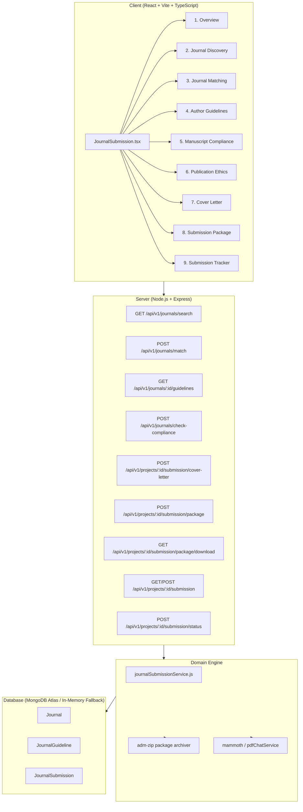
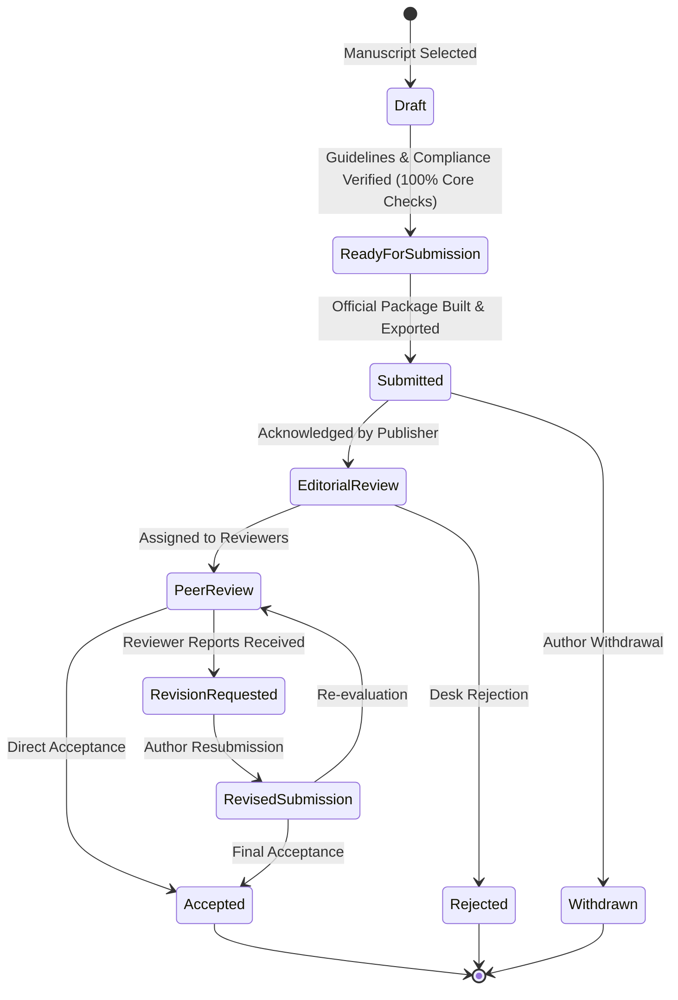

# RESEARCHPROOF AI 1.0 — PHASE 9 IMPLEMENTATION PLAN
## JOURNAL SUBMISSION STUDIO

**Date:** October 31, 2026  
**Status:** In Progress / Approved for Implementation  
**Architect:** Principal Full-Stack Engineer & Scholarly Metadata Specialist  

---

## 1. Executive Overview & Scope

The Journal Submission Studio is the scholarly publishing subsystem of **ResearchProof AI 1.0**. It guides researchers from an active empirical manuscript to submission package delivery through a rigorous, evidence-grounded workflow:
1. **Manuscript Selection & Parsing**: Select existing project manuscripts or upload DOCX/PDF/TXT drafts.
2. **Journal Discovery**: Multi-parameter search across verified scholarly venues (Crossref, DOAJ, OpenAlex provenance).
3. **Journal Matching**: Multi-attribute heuristic matching against manuscript attributes (title, abstract, keywords, methodology, sample size) without presenting fake acceptance probability scores.
4. **Author Guidelines Verification**: Traceable word count limits, abstract standards, citation style, and figure requirements.
5. **Manuscript Compliance Checker**: Automated audit of manuscript sections, word counts, formatting, and references with clear statuses (`passed`, `failed`, `needs_review`, `not_verifiable`).
6. **Reference & Citation Audit**: Cross-checks bibliography items against verified styles (APA 7, Vancouver, IEEE, MLA, Chicago).
7. **Publication Ethics Checklist**: Author-verified declarations for ICMJE authorship, originality, COI, IRB ethics, consent, and AI usage disclosure.
8. **Academic Cover Letter Generator**: Generates formal, editable cover letters with export to DOCX/Text.
9. **Submission Package Builder**: Compiles a verified ZIP package containing the manuscript, cover letter, ethics declarations, compliance report, and a cryptographically hashed `manifest.json`.
10. **Submission Tracker**: Chronological tracking of submission milestones (`draft`, `ready_for_submission`, `submitted`, `editorial_review`, `peer_review`, `revision_requested`, `revised_submission`, `accepted`, `rejected`, `withdrawn`).

---

## 2. Technical Architecture & Component Tree

---

## 3. Data Flow & State Machine

---

## 4. Execution Sequence

- **Step 1**: Write `PHASE_9_IMPLEMENTATION_PLAN.md`.
- **Step 2**: Add models to `server/src/models.js` (`Journal`, `JournalGuideline`, and expanded `JournalSubmission`).
- **Step 3**: Create `server/src/journalSubmissionService.js` with verified journal directory, matching engine, compliance checker, cover letter builder, and ZIP package creator.
- **Step 4**: Implement REST endpoints in `server/src/index.js`.
- **Step 5**: Enhance `client/src/modules/JournalSubmission.tsx` with all 9 studio views, styling in `client/src/styles.css`.
- **Step 6**: Author automated tests in `server/test/phase9_journal_studio.test.js`.
- **Step 7**: Generate all required Phase 9 markdown documentation reports.
- **Step 8**: Verify production build (`npm run build --prefix client`).
