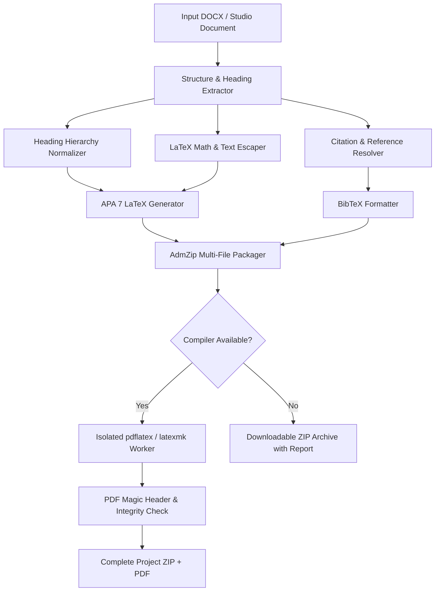

# ResearchProof AI — Phase 5: DOCX-to-LaTeX Conversion Pipeline

## 1. Architectural Overview

The conversion pipeline translates Word documents (`.docx`), markdown drafts, or structured studio documents into a complete, modular APA 7 LaTeX package.



---

## 2. Heading Normalization & APA 7 Levels

The pipeline maps headings to the five official APA 7 heading levels:

| APA Level | Visual Specification | LaTeX Command |
|---|---|---|
| **Level 1** | Centered, Bold, Title Case | `\section{...}` |
| **Level 2** | Flush Left, Bold, Title Case | `\subsection{...}` |
| **Level 3** | Flush Left, Bold Italic, Title Case | `\subsubsection{...}` |
| **Level 4** | Indented, Bold, Title Case, Ending with Period | `\paragraph{...}` |
| **Level 5** | Indented, Bold Italic, Title Case, Ending with Period | `\subparagraph{...}` |

### Heading Hierarchy Integrity Checks
- Detects skipped heading levels (e.g. jumping directly from Level 1 to Level 3 without a Level 2 intermediate).
- Generates a warning in `conversion-report.json` without truncating text.

---

## 3. LaTeX Text Escaping & Scientific Notation Preservation

### Escaping Rules
Plain text characters with reserved LaTeX meanings are escaped:
- `&` → `\&`
- `%` → `\%`
- `#` → `\#`
- `_` → `\_`
- `{` → `\{`
- `}` → `\}`
- `~` → `\textasciitilde{}`
- `^` → `\textasciicircum{}`
- `\` → `\textbackslash{}`

### Scientific Notation & Statistics Preservation
Statistical values and math tokens are protected prior to escaping:
- $p$-values: `p < .05` → `$p < .05$`
- $F$-statistics: `F(1, 42) = 5.23` → `$F(1, 42) = 5.23$`
- Greek symbols: `alpha = .05` → `$\alpha = .05$`
- Effect sizes: `eta^2 = .14` → `$\eta^2 = .14$`
- Sample sizes & means: `M = 24.2`, `SD = 3.1` → `$M = 24.2$`, `$SD = 3.1$`

---

## 4. Tables and Figures

### Booktabs Tables
Tables are converted to clean `booktabs` format without vertical lines:
```latex
\begin{table}[htbp]
  \caption{Participant Demographics}
  \label{tab:table1}
  \centering
  \begin{tabular}{lrr}
    \toprule
    Condition & Sample Size (N) & Mean Age (SD) \\
    \midrule
    Control & 45 & 21.4 (2.1) \\
    Experimental & 48 & 21.8 (2.4) \\
    \bottomrule
  \end{tabular}
  \par\vspace{4pt}\raggedright{\footnotesize \textit{Note.} Baseline values.}
\end{table}
```

### Figures
Extracted figures are saved in the `figures/` directory and referenced via:
```latex
\begin{figure}[htbp]
  \centering
  \includegraphics[width=\textwidth]{figures/figure1.png}
  \caption{Working Memory Performance Across Experimental Trials}
  \label{fig:fig1}
\end{figure}
```
